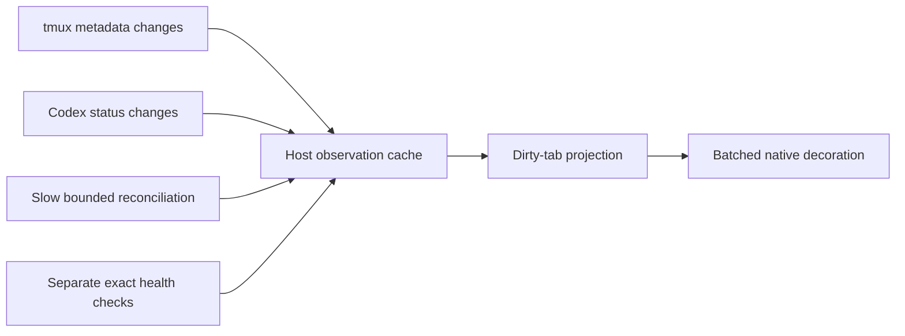

# Low-overhead tab activity, health and formatting research

## Scope, sources and stopping rule

Question: how can Wake keep tab activity, health and formatting current without
repeated expensive whole-workspace investigation?

Primary sources only: current installed/repository Wake source, retained native
Codex source, official release-tagged Codex source/protocol, and tmux's own manual
and control-mode documentation. Stop after tracing current costs, identifying
usable event signals and ownership limits, and recommending a bounded first slice.
This is research, not an implementation plan or live acceptance experiment.
Research conducted locally because source tracing and synthesis share the critical
path. Graphiti historical discovery skipped: this investigation concerns current
code and current primary-source contracts, with contemporaneous evidence supplied.

Inspected 2026-11-10: Wake installed source `7010cbeb6f8870c50360382ebe01248e2a1824ed`,
repository HEAD `fa2363c24bf921ecf0bd8390739e96041e620e8f`. Eight relevant source
modules were byte-compared with that installed prefix and matched. Installed CLI
reports Codex 0.167.0 and tmux 3.4. Retained native source checkout reports commit
`a4cad1365c850a9c6a14efe004adf84b51fbf7ad`; external Codex claims below additionally
use the official `rust-v0.167.0` source, not a claim that this entire local checkout
is stock. No threads were resumed, prompts sent, monitor started, or settings changed.

## Findings: current cost comes from reconstructing evidence

1. **Each monitor refresh starts fresh probe processes.** `_probe` starts a Python
   child; refresh invokes discovery and then selected workspace probes serially.
   Each child reconstructs the controller. Defaults are five-second intervals,
   1.5-second probe limits and a ten-second cycle; the daemon allocates 65% of the
   cycle to observation before formatting/routing. These are deadlines, not proof
   that a large workspace finishes within them. [Monitor source][W1]

2. **A public tab read can investigate each pane twice.** It first collects traits,
   then, when Codex is detected, fetches native session rows and repeats window
   observation with those rows. The second pass repeats process inspection and
   visible-error detection; qualified health probing becomes possible with native
   bindings. `session_rows` can also obtain a tmux pane inventory when the caller
   does not provide one. [Controller read path][W2], [trait/session implementation][W3]

3. **Cheap and deep observations are coupled.** `_processes` walks only the pane's
   same-user descendants, bounded to 256 identities; it is not itself a host-wide
   process scan. It reads command/path/executable/birth metadata. Trait observation
   can then challenge a pinned TUI and capture the current visible pane to look
   for bottom-of-screen error markers. A health fallback can enumerate `/proc`
   when an exact client process is absent. This is materially more than obtaining
   a tab name or a turn's running/idle state. [Traits][W3], [exact health][W4]

4. **Hash caching exists, but its lifetime is too short for this polling model.**
   Both trait build identification and controller health cache executable hashes
   by file identity/stat metadata. Those are process-local caches. Fresh probe
   children lose them between probes/cycles. Thus hashing can repeat across child
   lifetimes; it is inaccurate to say every pane always hashes the binary or that
   the code has no hash cache. No CPU/I/O profiler in this research quantifies the
   share attributable to hashing. [Trait digest][W3], [health digest][W5]

5. **The existing metadata reader is deliberately a snapshot reader.** It allows
   initialize/list/read requests and discards unsolicited frames without IDs.
   Reusing this class unchanged will not deliver an activity-event cache. The
   formatting bridge, however, already accepts a trusted snapshot without another
   trait investigation. [Reader][W6], [formatting bridge][W7]

Prior isolated rendering measurements are evidence for a separate, already fixed
bottleneck: native formatting process launches fell from 1,728 to 275; the exact
private installed 42-window formatting refresh took 0.271s, enable 0.818s and
rollback 0.430s. These are fixture rendering results, not whole-monitor or loaded-
host latency guarantees. Live monitor performance remains unqualified and the
monitor remains stopped in the latest deployment receipt. [Retained measurements][E1],
[current deployment boundary][E2]

## Available primary-source signals

| Need | Source-supported signal | Important boundary |
| --- | --- | --- |
| Tab/pane layout and names | tmux control-mode notifications and format subscriptions | Metadata can invalidate bindings; a name is not conversation identity. |
| Pane foreground command/path/death | tmux format fields/subscriptions | A command name is a discovery hint, not proof of build or native session ownership. |
| Codex activity/waiting flags | `thread/status/changed` and initial metadata reads | Activity is distinct from responsiveness of the controlling TUI. |
| Exact TUI health | Existing pinned `tui/health/*` owner | Run separately/on demand; preserve process-generation checks. |
| Visible red error | Existing guarded visible-screen observation | Structured `systemError` does not establish what is currently visible on screen. |

The tmux 3.4 manual provides `-C`, `no-output`, `ignore-size`, and metadata
subscription notifications, capped at once per second. Its window/pane/session
notifications support binding invalidation. A metadata client should disable pane
output, avoid detaching/resizing real clients, and use a command allowlist: the
`read-only` flag's documented keyboard behavior is not a general prohibition on
control commands. [tmux 3.4 manual][T1], [maintainer control-mode guide][T2]

**Codex activity has a promising passive path.** In official 0.167.0 source,
`ThreadWatchManager` publishes status transitions via `send_server_notification`;
that method queues a broadcast when no connection IDs are specified. Status facts
cover running state, pending input/permission and system errors. This supports a
persistent observer for basic activity without assuming that detailed turn/item
subscriptions are required. [Status producer][C1], [broadcast routing][C2]

This is source evidence, not a successful passive-stream experiment against the
installed modded/stock daemon. Validate initialization, notification filters,
reconnect and delivery before adopting it. Detailed thread events have separate
subscription/lifetime behavior; do not call `thread/resume` just to obtain badges.
A connected metadata channel is not evidence that a TUI is responsive. The current
native schema contains status notifications and metadata reads, but that alone
is not delivery acceptance. [Official protocol][C3], [Wake reader boundary][W6]

## Recommended design (inferences and proposed acceptance, not shipped behavior)

**First, remove repeated investigation without waiting for every harness to gain
an event adapter.** Maintain one observation owner with a bounded process/native-
metadata cache; collect each pane once per reconciliation and enrich that same
record rather than walking it again. Isolate risky operations behind a bounded
worker pool so a stuck endpoint cannot stall or leak the persistent owner. Preserve
existing exact binding, birth, ownership and privacy checks. This recommendation
follows directly from the duplicate-read and child-cache-lifetime findings above.

Then add persistent tmux metadata and Codex status feeds, scoped per verified
terminal/native server, not per tab. Initial bounded snapshots seed the cache;
reconnect starts a new epoch and reconciles before accepting deltas. Coalesce
changes and render only dirty windows. Lost/discontinuous events invalidate affected
traits, not every known tab name, stable palette or entire original baseline.

Keep separate schedules and evidence fields:

- Stable identity/build: qualify at discovery/change; recheck stat/birth/manifest
  generation before reuse. Never cache by filename or PID alone.
- Turn activity: use status deltas where delivery qualifies; retain a slow bounded
  snapshot fallback. Do not interpret a quiet long-running turn as stale merely
  because its last transition was over 20 seconds ago.
- Health: explicit requests, suspected failures, or a separately budgeted sweep.
  No health RPC should be required merely to paint an unchanged tab.
- Visible errors: bounded/coalesced checks only when that observation is enabled;
  prefer a future qualified native visible-error signal. Raw output streaming or
  text persisted to an observation cache is not needed for basic activity.
- Display: keep the user's selected palette stable. On channel loss, discard or
  neutralize uncertain activity/attention cues while keeping detailed provenance
  available in inspection. Stable theme selection needs no freshness clock.

Proposed acceptance targets: zero new probe processes and zero executable hashing
for an unchanged steady-state rendering tick; no deep health requests for painting;
no writes to unchanged tabs; bounded queues and worker count; prompt update after
an observed event; reconnect/PID-reuse/generation loss produces explicit unknown.
Targets require measurement on 44+ live-equivalent tabs, both idle and active,
including CPU, RSS, hash bytes, native RPCs, subprocesses and write counts. Set
numeric CPU/RSS/latency limits from a measured baseline, not these historical
fixture timings. A slower full sweep is recovery, not the normal display path.

## First implementation packet and unresolved limits

1. Instrument a private 44-tab observation fixture: count pane walks, native
   sessions, unique hash misses/bytes, health calls, captures and subprocesses.
2. Remove the second pane walk and reuse one metadata inventory; prove unchanged
   identity/privacy/unknown outcomes at the same public seam.
3. Qualify one passive native status connection plus one tmux metadata observer;
   test reconnect and burst coalescing without model turns or live layout changes.
4. Feed the existing formatting-snapshot seam and prove unchanged tabs cost no
   redraw work. Include explicit close/detach/worker-resource cleanup receipts.

Do not broaden this into daemon replacement or a new Windows service. Native
psmux/Grok/SSH/Claude/open harnesses need their own capability checks and fallbacks;
tmux or Codex event availability proves none of those. Stock Codex can remain
unchanged if its existing status broadcast path qualifies. Only if qualification
fails should a narrowly scoped adapter/harness change be considered.

Bound reached: costs, source-backed signals, subscription caveat and a bounded
first slice identified. No implementation, benchmark rerun, service change,
production polling, raw terminal capture or provider call was performed. Only this
research note was added; the preexisting `.codex/config.toml` edit was preserved.
Memory disposition: forbidden; no explicit memory-write request, as required by
higher-priority memory instructions. Non-write receipt remains in user state.

[W1]: https://github.com/CochranResearchGroup/codex-wake/blob/7010cbeb6f8870c50360382ebe01248e2a1824ed/src/codex_wake/tab_monitor.py#L240
[W2]: https://github.com/CochranResearchGroup/codex-wake/blob/7010cbeb6f8870c50360382ebe01248e2a1824ed/src/codex_wake/controller_tabs.py#L130
[W3]: https://github.com/CochranResearchGroup/codex-wake/blob/7010cbeb6f8870c50360382ebe01248e2a1824ed/src/codex_wake/tab_traits.py#L49
[W4]: https://github.com/CochranResearchGroup/codex-wake/blob/7010cbeb6f8870c50360382ebe01248e2a1824ed/src/codex_wake/local_health.py#L37
[W5]: https://github.com/CochranResearchGroup/codex-wake/blob/7010cbeb6f8870c50360382ebe01248e2a1824ed/src/codex_wake/controller_health.py#L32
[W6]: https://github.com/CochranResearchGroup/codex-wake/blob/7010cbeb6f8870c50360382ebe01248e2a1824ed/src/codex_wake/shared_app_server.py#L25
[W7]: https://github.com/CochranResearchGroup/codex-wake/blob/7010cbeb6f8870c50360382ebe01248e2a1824ed/src/codex_wake/tab_format_monitor.py#L5
[E1]: ../evidence/plan0213/installed-proof.log
[E2]: ../evidence/plan0215/deployment.json
[T1]: https://github.com/tmux/tmux/blob/3.4/tmux.1
[T2]: https://github.com/tmux/tmux/wiki/Control-Mode
[C1]: https://github.com/openai/codex/blob/rust-v0.167.0/codex-rs/app-server/src/thread_status.rs#L135-L228
[C2]: https://github.com/openai/codex/blob/rust-v0.167.0/codex-rs/app-server/src/outgoing_message.rs#L791-L831
[C3]: https://github.com/openai/codex/blob/rust-v0.167.0/codex-rs/app-server-protocol/src/protocol/common.rs
