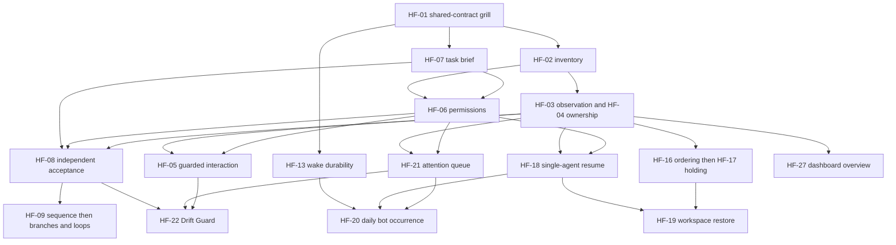

# Agent harness backlog: reconciled ticket drafts

State: OPEN
Ticket state: HF-01 DONE (design only); HF-02/HF-06/HF-07/HF-13 specs approved; others TRIAGE. GitHub owns execution state.
Owner: ecochran76
Work item: CW-HARNESS-173 (local planning intake; not posted)
Lane: P173-PLAN
Branch: docs/agent-harness-backlog
Base: 7ef73b1
Target: origin/main
Integration: squash_pr
Decision status: HF-01 scenario decisions resolved; later feature designs pending

## Outcome and authority

Organize the conversation's agent-controller features into nonduplicative,
copy-ready tickets with clear ownership, evidence, dependencies and scope. This
packet performs planning only: no implementation, provider tests, production
changes or manipulation of real tabs. The user explicitly requires each selected
item to start with Matt's grill-with-docs process. More than a few interview
questions use Previews. No new GitHub issues, labels, milestones or projects are
created by this ticket-design packet.

[32 ticket drafts and coverage map](0173-agent-harness/README.md).
The individual Markdown drafts own scope/acceptance. `index.json` is a generated
projection for navigation and dependency validation, not another specification.

## Current state

HF-01 is complete as a design ticket; [decisions and handoffs](0173-agent-harness/hf-01-decisions-and-handoffs.md)
record the seven operator answers. HF-02–HF-32 remain TRIAGE, not implementation-ready. Every later item retains its own interview and an
approved implementation handoff, even after technical prerequisites finish.
Priority expresses proposed product value, not execution authority. No coding
starts from an automatically inferred READY label.

Current baseline is released source0.20.0/main7ef73b1. Existing Codex discovery,
spawn/refresh/handoff, scoped A2A claims/replies, durable wakes and qualified
resource controls are reused. The managed Grok open-TUI wake/A2A route is qualified;
its native caller attestation, saved lifecycle and strict resource guarantees are
not. Nothing in this backlog retroactively expands those guarantees.

## Reconciliation: one owner per shared concern

| Shared concern | Owning ticket(s) | Consumers / eliminated duplication |
| --- | --- | --- |
| Logical managed identity, attachment/profile/repo links | HF-02 | Tab organization, adoption, resume, dashboard and runtime ports use one inventory. Labels/indexes remain presentation. |
| Typed observation, freshness and wait | HF-03 | Drift Guard, layout dormancy, branches and dashboard share state vocabulary. No feature maintains an independent busy detector. |
| Resource ownership and input control | HF-04 / HF-05 | Worktrees/prefixes and terminal interactions share admission/ownership rules; human takeover fences automation. |
| Host permission/profile rules | HF-06 | Workflow steps, account-aware resume and UI actions use existing grants. No credential vault or grant-by-title. |
| Task brief/context and independent acceptance | HF-07 / HF-08 | Branches, loop termination, reviews, Drift Guard and completion use one declared task/acceptance contract. |
| Workflow program position and attempts | HF-09 | Branch/loop/join/debugging extend one execution record; the dashboard and recorder do not become schedulers. |
| Wake lifetime, occurrence and background completion | HF-13 / HF-14 / HF-20 | Existing persisted intents remain the wake authority. Exactly one selected owner computes daily recurrence. |
| Layout versus process/conversation recovery | HF-16 / HF-17 / HF-18 / HF-19 | Reordering/parking live views is distinct from resuming dead clients and reconciling a full restored workspace. |
| Human decisions and escalation | HF-21 | Approval, auth, Drift Guard and recovery feed one attention queue; dashboard is a consumer. |
| Cumulative accounting and qualified enforcement | HF-23 / HF-24 | Existing objective ledgers and strict controls remain authoritative. Reporting unknown usage is separate from enforcement. |
| Diagnostic evidence and runtime qualification | HF-25 | Adapter recording/replay feeds conformance tests; replayed fixtures never become live acceptance or a second workflow journal. |
| Operator presentation | HF-27 / HF-28 / HF-29 | Overview, controls and economic projections share backend records; no UI-owned agent or workflow state. |
| Final artifact handoff and retirement | HF-30 | Consumes existing acceptance/ownership/job records, preserving unresolved work rather than declaring an unrelated done state. |

No ticket says "build the orchestration framework" or "build a plugin system."
Each implementation draft delivers one observable slice, with CLI/MCP/backend
capabilities before optional presentation. HF-01 is a bounded design/interview
prerequisite, not a mandate for a large framework implementation.

## Existing work and duplicate handling

- [#282](https://github.com/CochranResearchGroup/codex-wake/issues/282) remains the
  owner of its public host-wiring/self-refresh operational gap. HF-06 and HF-26
  inspect/reuse that disposition; they do not duplicate or silently close it.
- [#270](https://github.com/CochranResearchGroup/codex-wake/issues/270) covers
  external enforcement exploration. HF-23/HF-24 first reconcile its remaining
  questions against already shipped ledgers/supervision/containment, then narrow
  only the incremental managed/cross-runtime scope.
- Existing webhook [#135](https://github.com/CochranResearchGroup/codex-wake/issues/135)
  and live-dispatch [#142](https://github.com/CochranResearchGroup/codex-wake/issues/142)
  stay separate. Await/job features consume supported triggers without acquiring
  deployment or live-dispatch authority.
- Basic persistence, native Codex lifecycle, A2A and per-pane serialization are
  existing capabilities. The tickets add explicit lifetime/ownership, portability
  and composition; none assumes those features are missing wholesale.

These are read-only tracker reconciliations. Older issue prose is evidence of
scope/history, not proof that every original gap still exists on current main.

## Proposed sequence and useful delivery paths

1. **HF-01 first:** grill the small shared identity/capability/ownership vocabulary
   and freeze the minimum contracts needed to split write ownership. Do not
   select a DSL, database or public plugin SDK merely to produce a blueprint.
2. **First parallel frontier:** HF-02 managed inventory, HF-07 task brief/context,
   HF-13 wake durability. Each still gets its own grill-with-docs. At most three
   implementation lanes are active, including the primary owner.
3. **Next frontier:** HF-03 observations, HF-04 resource ownership and HF-06
   step permissions. Shared hub/schema/profile edits have one integration owner.
4. **Prioritize concrete user outcomes:** single-agent resume HF-18, attention
   HF-21, independent acceptance HF-08, and tab ordering HF-16. Select a maximum
   of three concurrent lanes rather than starting every ready draft.
5. **Daily-task path:** HF-13 + HF-18 + HF-21 lead to HF-20. It does not wait for
   the workflow language, dashboard, Grok lifecycle or a third runtime. Recurrence
   authority, timezone/DST, lateness and overlap are grilled before implementation.
6. **Flow-control path:** HF-07/HF-08 plus the managed controls lead to HF-09
   bounded sequences, HF-10 branches, HF-11 finite collections and HF-12 bounded
   repeat/progress checks. HF-14 jobs can proceed independently of the workflow
   interpreter, then join HF-11 in HF-15 parallel teams/joins.
7. **Drift Guard early:** HF-05 + HF-08 + HF-21 lead to HF-22 using existing owned
   native-turn supervision. It does not require the full workflow interpreter,
   loops, dashboard or portable accounting to provide a first qualified slice.
8. **Workspace path:** HF-16 ordering -> HF-17 live holding; HF-18 single-agent
   recovery plus HF-17 -> HF-19 complete workspace restore. HF-32 adds opt-in
   automatic organization only after manual controls/protection/attention work.
9. **Console path:** HF-27 read-only overview/attach follows inventory/observation
   and can ship early. HF-28 adds existing authorized controls/flow debugging after
   their backends; HF-29 economic views follow real accounting/acceptance evidence.
10. **Extensions:** HF-23/24 portable budgets, HF-25 conformance recording,
    HF-26 Grok lifecycle, HF-30 completion/retirement and HF-31 one selected extra
    runtime proceed through their explicit prerequisites. A new runtime does not
    need to wait for all Grok lifecycle work; both consume the same qualified
    contracts/conformance interface.

The generated index lists technical frontiers. Frontiers are not simultaneous
write assignments, priority orders or automatic implementation authorization.
HF-01 is the recommended next interview, not permission to begin implementation.

## Delivery paths at a glance

This is a compact view; the ticket index owns the complete prerequisite list.

## Parallel-write collision map

| Shared edit surface | Tickets likely to collide | Integration rule |
| --- | --- | --- |
| Session inventory/bindings/target resolution | HF-02/03/18/19/26/31 | Freeze shared identity changes; separate adapter/leaf work; one owner integrates common projections. |
| CLI/MCP registration and host profiles | HF-05/06/16/18/21/24/26/28 | Never assign competing writes to the same hub; workers deliver disjoint leaves and primary wires them serially. |
| Wake schema/clock/monitor policy | HF-13/14/20 | Preserve schema/default compatibility and original deadline authority; one owner for record changes. |
| Workflow execution/cursor/attempt schema | HF-09/10/11/12/15/22/28 | One owner per shared execution-contract revision; consumer/read-only work can proceed separately. |
| Terminal layout and human input | HF-05/16/17/19/32 | Shared mutation ownership and exact snapshots; serialize real effects even if implementation files are disjoint. |
| Usage and host execution policy | HF-06/23/24 | Extend existing authoritative ledgers/controls; no independent counters or resets in each runtime. |
| Dashboard frontend | HF-27/28/29 | One frontend owner at a time; stable read/action contracts permit independent backend work. |

A file collision is not falsely modeled as a semantic feature prerequisite. It
constrains write assignment and integration, while technical edges describe what
must already exist for the outcome. Parallel discovery never repeats the same
CodeGraph investigation; this planning packet used one primary owner.

## Decisions deliberately retained for each grill

The backlog resolves component ownership and sequencing, not unasked product
choices. Open decisions include manual versus opt-in automatic layout; activity
versus repo priority; dormancy; dashboard form/deployment; workflow syntax and
verified expressions; what a runtime can truly interrupt; reviewer/correction
budgets; recurrence owner; missed-run/overlap policy; resume account/history
access; resource measurement versus enforcement; and the first additional TUI.

The HF-20 interview must resolve the actual codex-bots repository and interface
before any cross-repository work. The original list does not authorize opening
another project, configuring services, credentials, real wakes or accounts.

## Acceptance and definition of done for this planning packet

- [x] Every discussed feature maps to one or more owning tickets; no unmapped group.
- [x] Every ticket has outcome, surfaces, prerequisites, acceptance, non-goals and unresolved decisions.
- [x] Existing shipped capabilities and open tracker overlaps are identified.
- [x] The dependency graph is acyclic with no unknown/self references.
- [x] Technical sequencing, parallel opportunities and shared-write ownership are distinct.
- [x] Every ticket starts with grill-with-docs and remains TRIAGE until its decisions/handoff are resolved.
- [ ] Operator reviews the proposed scope and sequencing before selecting an interview.

Planning output is complete when these drafts, coverage and ordering can be
reviewed together. It is not implementation completion, external issue creation
or approval of all policy choices. Source/glossary/links and graph checks are
planning validation, never runtime qualification. Plan0172 remains the authority
for the released0.20.0 work and existing acceptance receipts.

## 2026-10-24 common session permissions reconciliation

Operator clarification in the issue310 repair conversation expands HF-06's
requirements to one globally configurable action policy. The [contract proposal](0173-agent-harness/session-permissions-contract.md)
records action ownership, configurable defaults/overrides, identity/effect scope,
A2A two-sided checks, wake-route distinctions, migration and acceptance. This is
a documentation amendment from branch docs/310-common-session-permissions into
docs/agent-harness-backlog; no shared worktree was edited. Existing interview and
implementation gates remain intact. No new ticket family or runtime policy store.

## HF-06 publication | 2026-10-24

The operator approved all nine common-permission decisions, final shared
understanding, public test seams, six vertical slices and blocking edges.
Children #320–#325 are specification-ready with 12 verified native blockers.
[Receipt](0173-agent-harness/hf-06-publication-receipt.json). HF-06 remains blocked
by inventory #315/task brief #316; wake slice also depends on #317. #318 owns
scoped-refresh execution; #319 owns observation-stop recovery. Those runtime
claims remain separate from permission/capability diagnostics. No implementation
or production effect was performed by publication.
